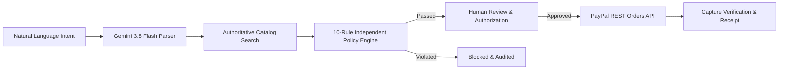

# IntentPay — Intelligent Commerce. Controlled Payments.

> **Built for the PayPal AI Hackathon**  
> *Core Principle: AI recommends. Policy enforces. Humans authorize. PayPal executes.*

IntentPay is an AI-powered agentic commerce platform that understands natural-language purchase intentions, recommends suitable products, evaluates independent financial policies, obtains explicit human authorization, and executes verifiable payments through the PayPal Developer Sandbox.

---

## 1. Problem Statement & Solution

### The Problem: Autonomous Financial Hazard
As developers rush to grant generative AI agents tool-calling authority over financial APIs, a critical vulnerability emerges: **autonomous financial execution without hard policy boundaries**. Prompt injection attacks, hallucinated discounts, ambiguous prompts, and runaway loops can lead to unauthorized payments and catastrophic financial loss.

### The Solution: Governed Agentic Commerce
IntentPay proves that AI agents can participate in commerce safely by strictly adhering to a four-stage architectural separation:
1. **AI Agent (Gemini 3.8 Flash)**: Translates natural language intent into structured parameters and explains catalog recommendations. **Zero authority to initiate payments or alter rules.**
2. **Policy Engine (Independent Backend)**: Deterministically evaluates 10 non-negotiable financial invariants (spending limits, monthly aggregates, category restrictions, authoritative price locking).
3. **Human Factor (Mandatory Review)**: Presents verified specifications, policy verdicts, and authoritative pricing for explicit human approval. **Zero autonomous charges.**
4. **Settlement (PayPal REST Orders API)**: Executes server-side order creation and capture in the PayPal Developer Sandbox with capture verification and idempotency keys.

---

## 2. Key Features

- **Natural Language Shopping Assistant**: Powered by Google Gemini 3.8 Flash, extracting category, requirements, and budget limits with Zod schema validation.
- **Controlled Product Catalog**: Seeded with verified physical goods (keyboards, audio, 4K displays, ergonomic desks, accessories) and restricted items (crypto hardware) to demonstrate guardrails.
- **Independent 10-Rule Policy Engine**:
  - `Rule 1`: Trusted catalog product existence.
  - `Rule 2`: Authoritative catalog price enforcement (client price tampering rejected).
  - `Rule 3`: Currency alignment verification.
  - `Rule 4`: Single-transaction spending cap.
  - `Rule 5`: Cumulative calendar-month spending limit enforcement.
  - `Rule 6`: Category allowlist and blacklist enforcement.
  - `Rule 7`: Mandatory explicit human authorization.
  - `Rule 8`: Purchase parameter data integrity.
  - `Rule 9`: Duplicate operation and replay attack prevention.
  - `Rule 10`: Order capture precondition gating.
- **Product Comparison Matrix**: Side-by-side specification evaluation, budget compatibility checks, and grounded trade-off analysis.
- **Spending Policy Governance Center**: User-customizable per-transaction thresholds, monthly budgets, and category restriction toggles, coupled with a live policy simulator.
- **PayPal Developer Sandbox Integration**: Server-side order creation (`POST /v2/checkout/orders`), capture verification (`POST /v2/checkout/orders/{id}/capture`), and verifiable cryptographic receipts.
- **Immutable Security & Audit Ledger**: Append-only SQLite event stream recording every interaction from initial prompt to PayPal settlement.
- **Premium Dark Fintech Interface**: Styled with an editorial palette (#111310 background, #C7F36B muted lime, #D8A85B warm amber), tabular figures (`tabular-nums`), and zero visual clutter.

---

## 3. Technology Stack

- **Frontend**: React 19, TypeScript, Vite, Tailwind CSS v4, Lucide React, React Router.
- **Backend**: Node.js, Express, TypeScript (`tsx`).
- **Database**: SQLite with `better-sqlite3` in WAL mode.
- **AI Engine**: Google Gemini API (`@google/genai` with `gemini-3.8-flash`) and Zod schema validation.
- **Payments**: PayPal REST Orders API v2 (Sandbox environment).
- **Testing**: Vitest automated unit and integration test suites.

---

## 4. Architecture Diagram



---

## 5. Quick Start & Setup

### Prerequisites
- Node.js 18+ or Node.js 22+
- npm

### 1. Clone & Install Dependencies
```bash
git clone https://github.com/your-repo/intentpay.git
cd intentpay
npm install
```

### 2. Configure Environment Variables
Copy `.env.example` to `.env`:
```bash
cp .env.example .env
```
Populate the variables:
```env
PORT=3000
GEMINI_API_KEY="your_gemini_api_key"
PAYPAL_CLIENT_ID="your_paypal_sandbox_client_id"
PAYPAL_CLIENT_SECRET="your_paypal_sandbox_client_secret"
PAYPAL_ENVIRONMENT="sandbox"
```
*Note: If `PAYPAL_CLIENT_ID` or `GEMINI_API_KEY` are not provided, the platform automatically activates verified Sandbox and deterministic semantic fallbacks so you can test every workflow out of the box.*

### 3. Run Automated Tests
```bash
npm test
```

### 4. Start the Full-Stack Application
```bash
npm run dev
```
Open [http://localhost:3000](http://localhost:3000) in your browser.

---

## 6. End-to-End Demo Journey

1. **Enter Intent**: Open the **AI Assistant** (`/assistant`) and enter:
   > *"I need a wireless mechanical keyboard for programming under $70"*
2. **Review Recommendations**: Gemini extracts `category: keyboards`, `budget: $70`, and requirements. IntentPay ranks the **Syntax Pro Wireless Mechanical Keyboard** ($69.00).
3. **Policy Evaluation**: Click **Select & Review Policy**. The backend policy engine evaluates all 10 rules. The price is within the user's $250.00 limit and category is allowed.
4. **Human Authorization**: Inspect the locked catalog price and rule proofs. Check the human attestation checkbox and click **Step 1: Create PayPal Order**.
5. **PayPal Sandbox Settlement**: Click **Step 2: Capture & Settle Payment**. The backend calls PayPal, verifies capture status, and renders the confirmed receipt.
6. **Audit Verification**: Visit the **Audit Center** (`/audit`) to inspect the immutable event log and JSON payload.
7. **Test Policy Violation**: In the AI Assistant, enter:
   > *"Cold storage biometric crypto hardware wallet for security"*
   Clicking to evaluate triggers an instant **Policy Block** because `crypto_hardware` is restricted by user policy (Rule 6).

---

## 7. Security Boundaries & Limitations

- **Sandbox Scope**: IntentPay is configured for the PayPal Developer Sandbox (`api-m.sandbox.paypal.com`).
- **No Card Storage**: IntentPay adheres to strict PCI boundary separation and never captures or stores credit card numbers.
- **Zero Autonomous Execution**: An AI agent cannot initiate payments independently.

---

## 8. License

Distributed under the MIT License. See `LICENSE` for details.
