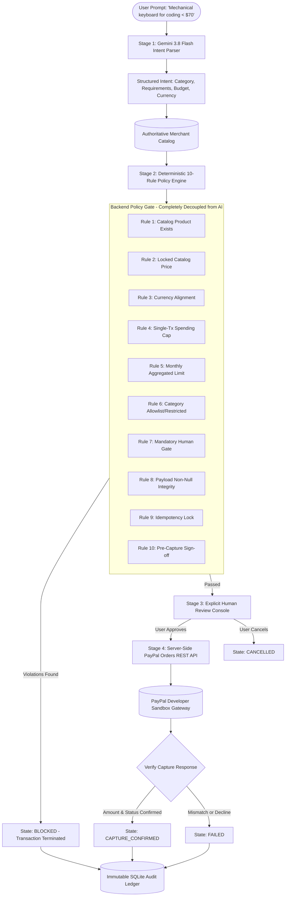

# IntentPay — System Architecture

## 1. Architectural Philosophy

IntentPay is built around the governing principle:
> **"AI recommends. Policy enforces. Humans authorize. PayPal executes."**

In traditional agentic commerce prototypes, developers often grant language models direct tool-calling authority over financial APIs. This pattern introduces critical security, non-repudiation, and financial vulnerabilities—including prompt injection attacks, budget evasion, and hallucinated discounts.

IntentPay decouples financial authority from machine learning inference through four isolated stages:

---

## 2. Component Taxonomy

### A. Intent Intelligence Engine (`server/src/ai/intentParser.ts`)
- **Model**: `gemini-3.8-flash` via `@google/genai` TypeScript SDK.
- **Header**: `User-Agent: 'aistudio-build'`
- **Validation**: Strict Zod schema enforcing typing on `category`, `requirements`, `maximumBudget`, `currency`, and `clarificationNeeded`.
- **Constraint**: Zero write permissions to payment credentials or transaction states.
- **Fail-safe**: Deterministic semantic fallback parser when API keys are absent or offline.

### B. Independent Policy Engine (`server/src/policies/policyEngine.ts`)
- Evaluates 10 hard deterministic rules without calling external LLMs.
- Queries SQLite directly for user limits, monthly totals, and category restrictions.
- Overrides any client-submitted pricing with authoritative `price_minor` from the catalog.

### C. PayPal REST Integration (`server/src/payments/paypalService.ts`)
- Direct integration with PayPal REST Orders API v2 (`/v2/checkout/orders` and `/v2/checkout/orders/{id}/capture`).
- Server-authoritative amount calculation.
- Duplicate capture prevention using strict idempotency checks and state transitions.

### D. Transaction State Machine
Transitions are forward-only:
1. `REQUEST_RECEIVED`
2. `INTENT_PARSED`
3. `PRODUCT_SELECTED`
4. `POLICY_EVALUATED`
5. `AWAITING_USER_APPROVAL`
6. `PAYMENT_ORDER_CREATED`
7. `CAPTURE_REQUESTED`
8. `CAPTURE_CONFIRMED`
*(Terminal exceptions: `BLOCKED`, `CANCELLED`, `FAILED`)*

### E. Database Layer (`server/src/database/db.ts`)
- SQLite with `better-sqlite3` and Write-Ahead Logging (`WAL`).
- All financial balances stored in integer minor units (cents).
- Foreign key cascading and indexed audit tables.
